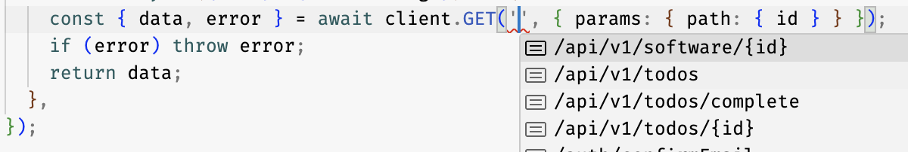

# Development

## API-First подход

Подобно тому как дизайн опережает разработку (в нашем случае), можно так же разрабатывать вначале фронтенд впереди бэкенда.

Чтобы не делать пустышки и не лепить временный харкод с данными на фронтенде, можно сразу делать моковые энпоинты, чтобы вся часть логики относящаяся к фронту уже шла от чего-то реального.

Так как все участники процесса имеют представление о языке заднего конца, такой подход имеет место быть.

### Software Item Example

Обобщение описание процесса разработки, на примере карточки ПО.

1. Создаем эндпоинт пустышку

   ```csharp
   // backend/Market
   public class GetSoftwareOut {
     public Guid Id { get; set; }
     public required string Name { get; set; }
     public required string Description { get; set; }
   }

   router.MapGet("/api/v1/software/{id}", Results<Ok<GetSoftwareOut>, NotFound> (Guid id, DbCtx db) => {
     return TypedResults.Ok(new GetSoftwareOut {
       Id = id,
       Name = "BIM-R",
       Description = "BIM-R — система для управления строительными проектами с использованием 4d-моделирования.",
     });
   }).WithOpenApi();
   ```

2. Благодоря TypedResults мы сразу получаем готовую openapi-схему на выходе

   ```json
   "/api/v1/software/{id}": {
     "get": {
       "parameters": [{
           "name": "id",
           "in": "path",
           "required": true,
           "schema": { "type": "string", "format": "uuid" },
       }],
       "responses": {
         "200": {
           "description": "OK",
           "content": { "application/json": { "schema": { "$ref": "#/components/schemas/GetSoftwareOut" } } }
         },
         ...
       }
     }
   }
   ...
   "GetSoftwareOut": {
     "type": "object",
     "required": [ "description", "name"],
     "properties": {
       "id": { "type": "string", "format": "uuid" },
       "name": { "type": "string", "nullable": true },
       "description": { "type": "string", "nullable": true }
     },
     "additionalProperties": false
   },
   ```

3. C помощью команды `pnpm openapi` обновляем типы на фронтенде: [frontend/shared/api/client.ts](frontend/shared/api/client.ts).

   И в апи клиенте появляется новый роут:

   ```ts
   const { data, error } = await client.GET('/api/v1/software/{id}', { params: { path: { id } } });
   ```

   data, error и даже сама строка /api/v1/software/{id} типизированы, т.к. мы пользуемся [openapi-ts](https://openapi-ts.dev/):

   

4. В качестве основного интрумента на фронтенеде мы используем [effector](https://effector.dev/).

   > [!NOTE]
   > Текст далее подразумевает что читатель с ним знаком.  
   > Eсли нет - в качестве отправной точки можно посмотреть на [effector-intro](https://github.com/borolgs/effector-intro)

   Оборачиваем запрос в query и связываем его с роутом карточки ПО. В случае ошибки - показываем уведомление и делаем редирект на 404 страницу (как пример!):

   ```ts
   // pages/software/model.ts

   // https://ff.effector.dev/api/factories/create_query.html
   export const softwareQuery = createQuery({
     effect: createApiEffect('get', '/api/v1/software/{id}', {
       mapParams: ({ id }: { id: string }) => ({ params: { path: { id } } }),
     }),
   });

   // Роут (и связанный с ним View) откроется только в случае если запрос за данными карточки будет успешен.
   // https://ff.effector.dev/api/routers/atomic-router.html#startchain
   export const softwareRoute = chainRoute({
     route: routes.software.item,
     ...startChain(softwareQuery),
   });

   // В случае ошибки вызываем событие showToast
   sample({
     clock: softwareQuery.finished.failure,
     fn: (): ToastMessage => ({ severity: 'error', summary: 'Unknown Error', detail: ':(((' } as const),
     target: showToast,
   });
   // И делаем редирект
   redirect({ clock: softwareQuery.finished.failure, route: routes.notFound });
   ```

   Подробнее про работу с [данными и квери тут](./frontend-fetching.md).

5. В компоненте просто подписываемся на данные из квери:

   ```tsx
   export const SoftwareCard = () => {
     const data = useUnit(softwareQuery.$data);
     if (!data) { return null; }

     return (
       <div className="flex flex-column gap-4 p-7">
         <Card
           title={
             <h2 className="flex flex-nowrap justify-content-between">
               {data.name}
             </h2>
           }
           ...
         >
         ...
         </Card>
       </div>
     );
   };
   ```

На выходе мы имеем почти готовый функционал, грамотно разрезанный на слои:

1. Доработка и переделка бэкенда точно будет синхронизирована с фронтом, разойтись им помешает openapi.  
   При изменении схемы на бэке, типа на фронте разломаются и мы вынуждены будет привести их в соответствие.
2. Вся логика обработки данных с бэкенда и весь флоу построения бизнес логики инкапсулированы в одном месте (page/model.ts) и никак не пересекаются с версткой.
3. Реакт компоненты чистые как слезы и отвечают только за одно: отображение данных

## Маршрутизация и алгоритм расширения

### Маршрутизация

Каждая папка — это маршрут.
Главный файл внутри — “страница” маршрута (например, index.tsx).
Динамические маршруты можно указывать через синтаксис [param].

Каждая страница соответствует маршруту приложения. Например:

- pages/login/index.tsx соответствует маршруту /login.
- pages/todos/[id].tsx соответствует маршруту /todos/:id.

Пример структуры:

 ```
frontend
├── pages
│   ├── login
│   │   └── index.tsx
│   ├── profile
│   │   ├── products
│   │   │   ├── index.tsx 
│   │   │   └── [id].tsx 
│   │   └── index.tsx
│   ├── todos
│   │   ├── index.tsx
│   │   └── [id].tsx
│   └── error
│       └── index.tsx
```

### Layouts
Использовать эти компоненты для оборачивания страниц.

 ```
frontend
├── shared
│   ├── ui
│   │   ├── layout
│   │   │   ├── index.tsx  
│   │   │   ├── layout.module.css  
│   │   │   ├── layout.tsx 
│   │   │   ├── PAGE GROUP NAME // название странице, которая группирует на уровне общего layout несколько страниц (пример страница Profile)  
│   │   │   │   └── index.tsx   
│   │   │   ├── PAGE GROUP NAME 2  
│   │   │   └──...  
│   │   │    
```

Пример использования

```{ route: routes.profile.self, view: ProfileView, layout: ProfileLayout },```
